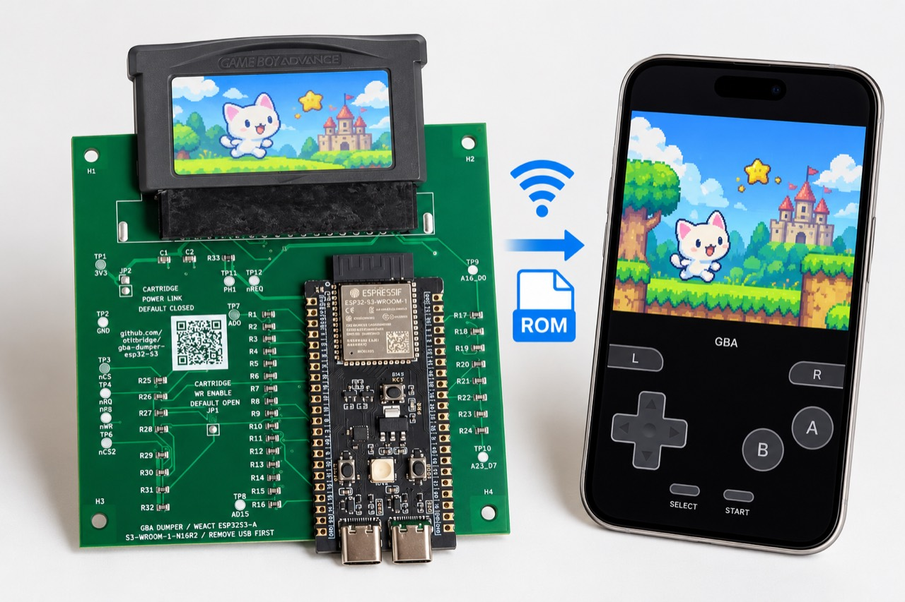
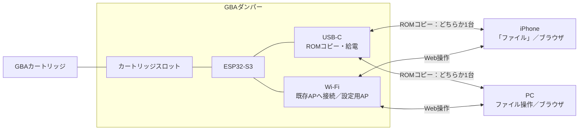

# GBAダンパー — バイナリ配布

**iPhoneの「ファイル」でROMを取り出し、ファームウェア更新もブラウザから。**
GBAカートリッジのバックアップを、スマホから使いやすく。これから始める人の「入門用の1台目」を目指しています。

- **USBケーブル1本でROMをコピー。** ネイティブUSBに接続すると「GBA-DUMPER」が表示され、iPhoneの「ファイル」やPCから取り出せます。Wi-Fi設定は不要です。
- **Wi-Fiではブラウザから操作。** ROMの読み出し・保存、対応するセーブデータのバックアップ・書込み・元データへの復元ができます。専用アプリのインストールは不要です。
- **更新のためにPCへつなぎ直す手間を減らす。** 初回導入・接続設定後は、ブラウザでGitHubの最新版を確認して更新できます。端末へ保存した署名付き更新ファイルを選ぶ方法にも対応します。
- **更新後の確認と、戻すためのしくみ。** 正規の更新ファイルかを署名で検証し、更新後に起動を確定できなければ旧版へ戻ります。有線書込みによる復旧経路も維持しています。

[使い方とセーブの復元](USAGE.md) ／ [ファームウェア更新](UPDATE.md) ／ [書込みと初回接続](INSTALL.md)

画像は利用方法を伝える説明用イメージです。[開発の様子をXで見る](https://x.com/ot_it_bridge/status/2111419544761925654)

WeAct ESP32S3-A N16R2と本プロジェクトのGBA用基板V1（20260928）向けの開発版ファームウェアです。
この配布物は **0.21.1 / public build**。ソースコード・最新の設計ファイルは配布しません。GitHubは書込み用バイナリ、操作説明、不具合報告の窓口として使用します。

0.21.1は、ROM読取りの処理負荷削減・小容量先読みと、保守のための責務分離・排他判断整理を反映します。USB MSC・Web UI・Wi-Fi・セーブ・署名付きファイル／GitHub更新を維持します。公開用アプリそのものをOTA導入・起動確定し、キングダムハーツ32 MiBはMacのUSBコピー437.7秒、WebSocket取得491.3秒で、それぞれ全量1回が原本一致しました。元セーブ独立2回・中断復帰も確認済みです。開発段階の測定・過去版のiPhone成功と区別して[検証状況](VALIDATION.md)へ記載します。

GitHubの最新版情報は0.21.1を配信しています。[GitHubからの更新・ファイル選択による更新](UPDATE.md)の手順を参照してください。

## 機器構成

## 対応と確認範囲

- ネイティブUSBの読み取り専用「GBA-DUMPER」からROMをコピー。各4 KiBブロックを2回読み、一致したデータを返します。
- Web UIとWi-Fi接続はUSB使用中も維持。カートリッジ操作は排他制御し、WebのUSB停止／有効化ボタンで切り替えます。
- ブラウザからROMの独立2回全量読出し・全バイト照合・保存。USBのブロック照合とは方式が異なります。
- 公式No-Introの登録情報からROM容量を設定。容量は物理測定による判定ではありません。
- EEPROMと確認済みキングダムハーツ32 KiBセーブの退避・書込み・元バックアップの復元。Web書込みは独自実機確認済みの設定だけを許可します。
- Wi-Fi接続設定・ESP32親機への自動切替・設定の保存。
- 開発用FWで「シナモン ふわふわ大作戦」4 MiB ROMとEEPROM 512 Bの読み書き・復元を実機確認済み。復元中断→再接続→元セーブ全量2回照合も確認済み。
- 公開用バイナリそのものの確認範囲は[VALIDATION.md](VALIDATION.md)を参照。過去版のiPhone動作報告と今回の公開用アプリそのものの確認を区別しています。
- 初期NVSからの親機パスワード生成、公開用0.21.1でのiPhone／Windows、iPhone／Windowsでの実32 MiB、処理中のUSB抜去・スリープ、他カートリッジは未検証。
- 8 KiB EEPROMは模擬試験のみ。SRAM/FRAM互換はB8CJ Rev0の32 KiBのみ対応。一般のSRAM／FRAM／Flash、32 MiB ROMのEEPROMは未対応。ROM容量が登録済みでも、そのタイトルのセーブ書込みまで検証済みという意味ではありません。

## 書込み・初期設定・操作

[書込みと初回接続](INSTALL.md)、[操作と復元](USAGE.md)を参照してください。対応基板以外には書き込まないでください。

初回のファームウェア導入・復旧にはPCを使います。Webの初回Wi-Fi設定ではUARTで機器の親機パスワードを取得します。USBでのROMコピーには、このWi-Fi設定は不要です。

配布用ビルドには開発者のSSID・Wi-Fiパスワード・OTA認証局を含めません。親機のパスワードは機器内で生成してNVSへ保存します。既存の保存済みWi-Fi設定と親機パスワードは維持されます。
0.14系以降は署名付きファイルをWeb画面から選んで更新できます。0.15系以降は、機器がGitHubから最新版を取得する方式にも対応します。[更新手順](UPDATE.md)。0.13.0からの初回移行と復旧にはUART側USBまたはネイティブUSBのBOOT／RESET書込みモードを使います。UART指令で開始する旧HTTPS方式は無効です。2つのUSBは同時接続しません。Web UIのHTML／JavaScriptと容量一覧は機器からブラウザへ配信され、利用者が閲覧できます。

## 不具合報告

[Issues](https://github.com/otitbridge/gba-dumper-esp32-s3/issues)で受け付けます。バージョン、基板・MCU、端末／ブラウザ、カートリッジ名、再現手順、エラー文を記載してください。
SSID・パスワード・認証トークン・ROM／セーブ本体・個人情報は添付しないでください。報告受付は修正時期や対応範囲の保証ではありません。

製品化に一緒に取り組む仲間を募集しています

利益を得ることより、試作から製品化までの経験を積むことを目的に、基板・筐体・製造検査・販売やサポートを一緒に考えてくれる方を探しています。動作する試作機と評価用バイナリがあります。最新の詳細設計・ソースコードはNDA後に、協業に必要な範囲で共有する予定です。既公開版と第三者素材のライセンス条件は維持します。

## 配布条件と履歴

自作ソフトウェアはMIT。バイナリにも適用され、表示条件を守った再配布・商用利用を認めます。[ライセンス](LICENSE.md)、[第三者表示](THIRD_PARTY_NOTICES.md)を確認してください。無保証の開発版です。ROM・セーブ本体や取得したヘッダ断片は配布しません。

過去の公開コミットには旧設計と旧ソースがあります。今回の更新は今後の配布内容を変更するもので、既に公開された内容や付与済みの権利を撤回するものではありません。過去版のライセンスは各版の表示に従います。
